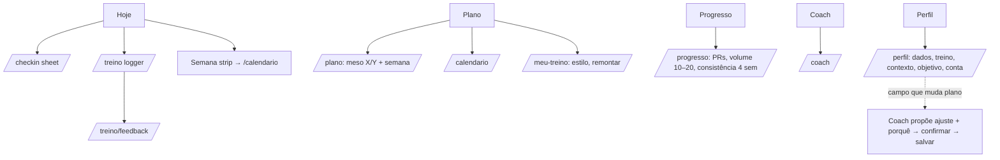

# Auditoria IA + Navegação — Coach Hypertrophy

Status: **APROVADO pelo iury em 29/10/2026** com 2 decisões: (1) **5 abas**, Perfil como aba própria; (2) **nova tela `/perfil`** pra editar campo a campo, sem refazer o onboarding. Não mexer em motor/regras.

## 1. Diagnóstico (código real, 29/10/2026)
Rotas existentes: `/`, `/entrar`, `/auth/confirm`, `/onboarding`, `/hoje`, `/checkin`, `/treino`, `/treino/feedback`, `/plano`, `/meu-treino`, `/calendario`, `/progresso`, `/coach`. **Não existe `/perfil`** — perfil = refazer `/onboarding` (link em /meu-treino e /hoje).
BottomNav atual: Hoje | Treino | Coach | Meu treino | Plano.

| Rota | Onde acessa hoje | Taps desde /hoje | Problema |
|---|---|---|---|
| /hoje | tab | 0 | Atalhos para check-in duplicados (3 links /checkin), sem link p/ calendário/coach |
| /treino | tab + CTA /hoje + /plano | 1 | Tab "Treino" sem sessão ativa = tela vazia/redirect; duplica CTA |
| /checkin | só links em /hoje | 1 | Ok, mas não tem estado "feito" visível |
| /plano | tab + link /hoje | 1 | Sobrepõe /meu-treino (dois "plano") |
| /meu-treino | tab + chip coach | 1 | Mistura config (estilo, remontar) com hub (progresso, calendário) |
| /calendario | **só** via /meu-treino ou /plano (texto pequeno) | 2 | **Escondido**; acende tab "Meu treino" |
| /progresso | /meu-treino, /treino/feedback | 2 | **Escondido**; resultados sem tab própria |
| perfil | /onboarding via /meu-treino | 2–3 | Sem tela de perfil/ajustes; editar = refazer onboarding inteiro |
| /coach | tab | 1 | Ok |

Problemas-chave: 2 tabs sobre "plano"; tab Treino redundante; Progresso e Calendário órfãos; sem Perfil/Ajustes.

## 2. Proposta — sitemap

## 3. BottomNav (5 itens) — aprovado
| Tab | Ícone (line) | Rota | Acende também em |
|---|---|---|---|
| Hoje | home/raio | /hoje | — |
| Plano | grid/calendário | /plano | /calendario, /meu-treino |
| Progresso | gráfico barras | /progresso | — |
| Coach | chat/sparkle | /coach | — |
| Perfil | user (line) | /perfil | /perfil/* |

Treino sai da tab (é ação do dia: CTA primário em Hoje e botão em Plano). 5 itens com label curto, alvos ≥ 44px; ícone line, sem preenchimento.
Oculta em: onboarding, entrar, checkin, logger ativo, feedback (já implementado — manter). Na edição de um campo do /perfil (sheet) a nav fica visível por baixo do sheet; no passo de confirmação do ajuste também.
Ativo: ícone + label lime, indicador `tab-motion` (pill desliza), inativo `text-faint`.

## 4. /hoje — blocos (cima → baixo)
1. Header: saudação + "Meso sem X/Y" (`meso-fill`). (Sem avatar — Perfil agora é aba.)
2. **Card Treino do dia (hero, CTA thumb zone)**
   - não iniciado: "Começar · {sessão} · ~{min}" `motion-cta-glow`
   - em andamento: "Continuar · série N/M" + barra `bar-fill`
   - feito: "Treino feito ✓" + resumo (volume, PR `pr-pop` se houver) → feedback/progresso
   - descanso: "Descanso" + próximo treino (dia) → secundário "ver semana"
3. **Check-in chip-card**: pendente = lime outline "Check-in 30s" → abre sheet (`sheet-enter`); feito = prontidão score neutro, toque edita. Só 1 entrada (remover duplicatas).
4. **Semana strip** (7 dias, ponto lime feito/hoje/planejado) → /calendario. Mostra consistência 4 semanas (sem streak punitivo).
5. **Coach atalho**: pergunta contextual ("Por que esse volume?") → /coach com prompt.
6. **Alerta** (quando existe: PAR-Q pendente, deload, prontidão baixa): banner topo acima do hero, 1 por vez, dismiss.
Entrada: `motion-stagger` nos blocos; `motion-press` em todos os cards.

## 5. Agrupamento
- **Hoje = fazer agora**: treino do dia, check-in, semana, alertas.
- **Plano = o quê e como**: /plano (meso, sessões), /calendario, /meu-treino (estilo, remontar).
- **Progresso = resultados**: PRs, volume/músculo vs faixa 10–20, consistência 4 sem, histórico.
- **Coach = perguntar porquê**.
- **Perfil = config (aba própria)**: dados, objetivo, tempo, contexto, nível, PAR-Q, conta.

## 6. Entry points
| Rota | Primário | Secundário |
|---|---|---|
| /treino | CTA hero /hoje | botão "Treinar" em /plano |
| /checkin | card /hoje | alerta prontidão |
| /calendario | segmento em Plano | semana strip /hoje |
| /meu-treino | segmento/ação em Plano ("Ajustar plano") | chip do coach |
| /progresso | tab | feedback pós-treino, card "feito" |
| /coach | tab | atalho /hoje |
| /perfil | tab Perfil | link "Mudar dias/equipamento" em Plano > Ajustar |

Plano: segmented control topo `Semana | Calendário | Ajustar` (chip-motion), cada um sua rota.

## 6b. /perfil — tela nova (aprovado)
Lista agrupada, cada linha = 1 campo com valor atual + chevron. Toque abre **sheet** (`sheet-enter`) reaproveitando o controle do step equivalente do onboarding (NumStepper, chips `chip-motion`, TimeBar, cards objetivo). Nada de refazer o onboarding.

| Grupo | Campos | Muda o plano? |
|---|---|---|
| Corpo | peso, altura | não (só registra; peso entra em histórico) |
| Treino | **dias/semana**, **minutos/sessão**, **nível (experiência)**, cardio/semana | dias, minutos, nível = **sim**; cardio = não |
| Contexto | **equipamentos**, **lesões/limitações** | **sim** |
| Objetivo | **objetivo** | **sim** |
| Segurança | PAR-Q | trava/destrava conforme regras existentes |
| Conta | e-mail, sair | não |

**Fluxo ao alterar campo que muda o plano** (dias, tempo, equipamento, lesão, objetivo, nível) — mesmo fluxo do fim do onboarding:
1. Usuário muda o valor no sheet → CTA "Ver ajuste" (não "Salvar").
2. Tela/sheet de **proposta do coach**: diff do plano (ex.: "4→3 dias: Upper/Lower vira Full Body 3×", volume por grupo antes/depois com `bar-fill`) + **porquê** em 1–3 linhas + badge de evidência. Números vêm do motor; coach só explica (P1).
3. Ações: **"Confirmar e salvar"** (primário, thumb zone, `motion-cta-glow`) · "Cancelar" (volta ao valor anterior, nada salvo).
4. Só após confirmar: grava perfil + plano novo, toast "Plano atualizado" + `pr-pop` leve no item; retorna a /perfil.
5. Campos que não mudam o plano salvam direto ao fechar o sheet, com toast discreto.

Regras: nenhum plano salvo sem confirmação; cancelar não deixa estado parcial; se o motor não precisar mudar nada, mostrar "Sem mudança no plano" e salvar o campo direto. Não alterar motor/regras — só chamar a mesma geração/ajuste usada no onboarding.

## 7. Microinterações de navegação
- Troca de tab: `tab-motion` (pill 200ms), conteúdo fade+4px slide 180ms.
- Sheet (check-in, editar perfil campo): `sheet-enter` 250ms, drag-down fecha.
- Voltar (sub-rotas fullscreen: logger, feedback, proposta de ajuste): header com ← ; slide-out direita 200ms.
- Proposta do coach: diff entra com `motion-stagger`; barras antes/depois com `bar-fill` 300ms.
- Tudo com `prefers-reduced-motion` → só fade.

## 8. Fora de escopo
Motor, regras de progressão, cálculo de volume/RIR/aquecimento, schema de dados, onboarding steps (só reuso).

## 9. Checklist Dev
- **P0**: BottomNav **5 itens** (Hoje·Plano·Progresso·Coach·Perfil) + active map; remover tabs Treino/Meu treino; hero /hoje com 4 estados; unificar entrada check-in; semana strip → /calendario.
- **P1**: rota **/perfil** (lista agrupada + sheets por campo reaproveitando controles do onboarding); **fluxo proposta → confirmar → salvar** para dias/tempo/equipamento/lesão/objetivo/nível; segmented Plano (Semana/Calendário/Ajustar); atalho coach contextual; banner alerta único; remover links "refazer onboarding".
- **P2**: card "feito" com PR/volume; transições voltar; deep link coach com prompt; diff visual antes/depois na proposta.

## 10. Critérios de aceite
- Toda rota alcançável em ≤2 taps de /hoje; calendário, progresso e perfil em 1.
- Editar qualquer campo do perfil sem passar pelo onboarding.
- Campo que muda o plano nunca salva plano sem "Confirmar e salvar"; cancelar reverte tudo.
- Nenhuma tab leva a tela vazia.
- CTA treino no thumb zone, um por tela.
- BottomNav oculta nos fluxos listados.
- Gamificação só com dados reais; sem streak punitivo.
- reduced-motion respeitado; log de série continua <15s (logger intocado; chips: aquecimento → top set → back off → trabalho).
